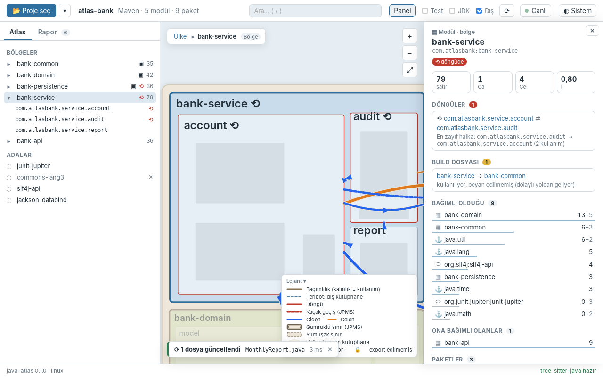
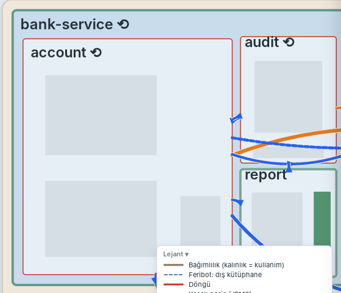
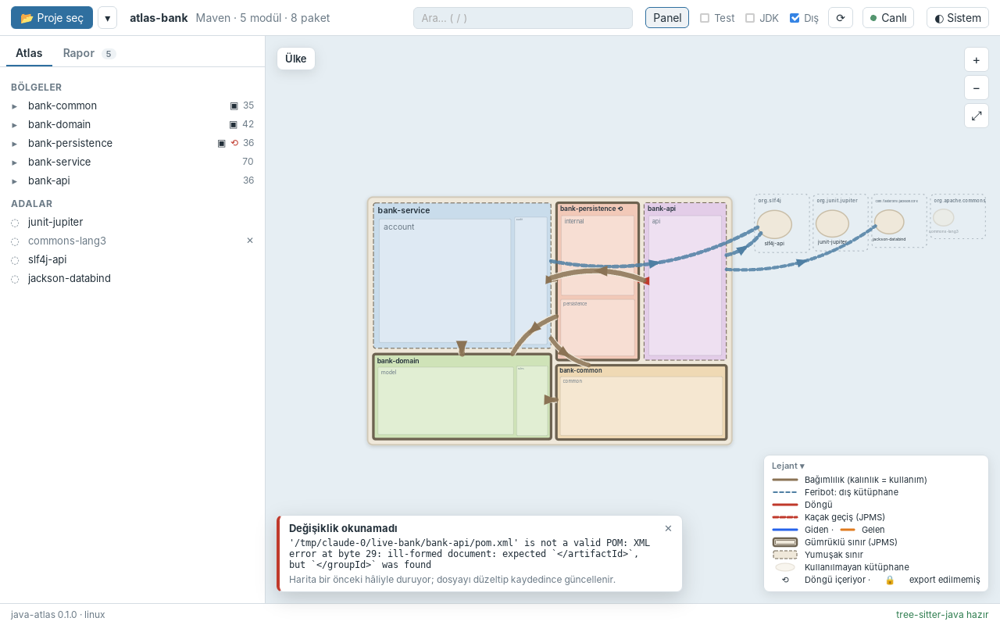

# Faz 8 — Canlı İzleme

> **Önceki:** [07 — Etkileşim ve bilgi panelleri](07-etkilesim-ve-paneller.md) · **Sonraki:** 09 — Büyük projeler *(yazılacak)*

## 1. Bu bölümde ne yapacağız

Şimdiye kadar atlas bir **fotoğraftı**: proje açılırken çekiliyor, kod değişince ⟳ ile yeniden çekiliyordu. Bu fazda haritayı **canlı** yapıyoruz:

- Proje açılınca klasörü izlemeye başlıyoruz (`notify`).
- Olayları **debounce** ediyoruz: bir kayıt dört olay üretebiliyor, `mvn compile` binlerce. Klasör 300 ms sessiz kalınca olaylar tek bir *batch*'e dönüşüyor.
- Değişen bir `.java` dosyası için **sadece o dosyayı** yeniden ayrıştırıyoruz; build dosyası (`pom.xml`, `build.gradle*`, `settings.gradle*`, `libs.versions.toml`) ya da `module-info.java` değişince tam tarama yapıyoruz.
- Yeni atlas hazır olunca Rust ön yüze bir **event** gönderiyor (`atlas-changed`). Harita yerinde kalıyor: kamera, ölçek, ekmek kırıntısı ve seçim aynı.
- Değişen modül, paket ve tipler haritada kısa bir süre **yeşil parlıyor**; köşede "1 dosya güncellendi · AuditLog.java · 2 ms" gibi bir bildirim çıkıyor.
- Araç çubuğundaki **● Canlı** düğmesi izlemeyi duraklatıyor (*Durdu*). Duraklatılmışken gelen değişiklikler biriktiriliyor, sürdürünce hepsi birden uygulanıyor.
- Yarım kaydedilmiş bir `pom.xml` uygulamayı bozmuyor: bildirim hatayı söylüyor, harita bir önceki hâliyle kalıyor.







## 2. Neden böyle

### Olgular dosya bazlı — artımlı tarama bedavaya yakın

Faz 1'de "olgular" katmanını kurarken verdiğimiz söz burada ödeniyor: bir `SourceFileFacts` **sadece kendi dosyasına** bağlı. `AuditLog.java` değişince yalnızca onun olgularını yenileyip analizi baştan çalıştırmak, tam taramayla birebir aynı sonucu veriyor. Ayrıştırma pahalı (Guava'da ~0,85 sn), analiz ucuz (~50 ms): pahalı kısmı tek dosyaya indiriyoruz, ucuz kısmı her seferinde baştan yapıyoruz. Grafı yerinde yamamaya çalışmak (bir kenarı silmek, döngüleri yeniden hesaplamak…) çok daha karmaşık ve hataya açık olurdu.

Build dosyaları farklı: bir `pom.xml` değişikliği modül ekleyebilir, kaynak klasörünü taşıyabilir, sürümleri değiştirebilir. Onu artımlı işlemeye değmez; tam tarama yapıyoruz. `module-info.java` de JPMS sınırlarını değiştirdiği için aynı sınıfta.

### "Planla" ve "uygula" ayrı

`java-atlas-scan` içindeki yeni `incremental` modülü iki adım:

1. **`plan`** neredeyse saf bir fonksiyon: değişen yolları "şunları yeniden ayrıştır" ve "her şeyi baştan tara" olarak sınıflandırıyor. Diskten tek sorduğu "bu yol bir klasör mü?".
2. **`apply`** planı uygulayıp olguları yamıyor.

Ayrım test edilebilirlik için: gürültü (`.class`, `README.md`, editör yedekleri) testi `plan`'ı çağırıp `is_empty()` bakmak kadar basit.

### Doğruluğun tek ölçütü: "artımlı = tam tarama"

Artımlı bir hesaplamanın en güzel testi, sonucunu sıfırdan hesaplanmışla karşılaştırmak. Testlerde örnek projeyi geçici bir klasöre kopyalıyor, dosyaları değiştiriyor, artımlı güncellemeyi uyguluyor ve sonucu aynı klasörün **tam taramasıyla** `assert_eq!` ile karşılaştırıyoruz. Dosyaların modül içindeki sırası bile aynı olmalı. Tek istisna uyarıların sırası, onu karşılaştırmadan önce sıralıyoruz.

### Channel değil, event

Faz 4'te ilerlemeyi `Channel` ile akıtmıştık. Channel **bir komut çağrısına** bağlı: ön yüz `open_project`'i çağırırken kanalı veriyor, komut bitince kanalın işi de bitiyor. Canlı izlemede kimse bir şey sormuyor; Rust bir değişiklik fark ediyor ve haber veriyor, uygulama kapanana kadar. Bunun Tauri'deki karşılığı **event**:

```rust
app.emit("atlas-changed", event)?;              // Rust: herkese duyur
```

```ts
listen<LiveEvent>("atlas-changed", (e) => …);   // TypeScript: dinle
```

Event'ler `core:default` izinlerinin içinde; capability dosyasına bir şey eklemek gerekmedi.

### Debounce'u kendimiz yazıyoruz

`notify` ekosisteminde hazır debouncer crate'leri var. Ama mantık 30 satır ve dersin özü tam olarak bu: bir kanal, `recv_timeout` ve iki süre. Ek bağımlılık da yok.

### Harita yerinde kalmalı

Bunu planda kamera ve seçim için düşünmüştük; ilk denemede asıl sorunun **yerleşim** olduğu ortaya çıktı. `bank-service`'e 9 satırlık bir sınıf eklemek bölgenin boyutunu değiştiriyor, squarified treemap da çocuklarını "büyükten küçüğe" sıralayıp satırlara ayırıyor. Sonuç: küçük bir değişiklikte şehirler yer değiştiriyor, `account` yatayken dikey oluyor. Bunu §3.6'da çözüyoruz.

## 3. Adım adım uygulama

### 3.1 `notify` ve debounce (`src-tauri/src/watch.rs`)

```toml
# src-tauri/Cargo.toml
notify = "8.2"
```

`notify` olayları kendi iş parçacığında bir closure'a veriyor. Orada sadece kanala iletiyoruz, asla beklemiyoruz:

```rust
let (tx, rx) = mpsc::channel::<notify::Result<notify::Event>>();
let mut watcher = notify::recommended_watcher(move |event| {
    let _ = tx.send(event);
})?;
watcher.watch(&root, RecursiveMode::Recursive)?;
```

Debounce döngüsü ayrı bir iş parçacığında çalışıyor:

```rust
const QUIET: Duration = Duration::from_millis(300);
const MAX_WAIT: Duration = Duration::from_secs(2);

while let Ok(first) = rx.recv() {          // watcher düşünce recv hata verir, döngü biter
    let mut batch = Batch::default();
    batch.add(first);
    let started = Instant::now();
    loop {
        let left = MAX_WAIT.saturating_sub(started.elapsed());
        if left.is_zero() { break; }
        match rx.recv_timeout(QUIET.min(left)) {
            Ok(event) => batch.add(event),
            Err(RecvTimeoutError::Timeout) => break,        // 300 ms sessizlik
            Err(RecvTimeoutError::Disconnected) => return,
        }
    }
    if !batch.is_empty() { on_batch(batch); }
}
```

İki süre iki ayrı derde çare:

- **`QUIET`:** bir kayıt "geçici dosya oluştur → yaz → asıl dosyanın üstüne taşı → metadata" diye dört olay üretebiliyor. Hepsi tek batch olsun diye klasörün durulmasını bekliyoruz.
- **`MAX_WAIT`:** izlenen klasörde uzun bir build çalışıyorsa olaylar hiç bitmeyebilir. Harita sonsuza kadar beklemesin diye en geç 2 saniyede bir batch teslim ediliyor.

`Batch` farklı yolların bir `BTreeSet`'i. Okuma olaylarını (`EventKind::Access`) atıyor. İşletim sisteminin kuyruğu taşarsa (`need_rescan()`) ya da arka uç hata verirse `rescan = true`: neyin değiştiği bilinmiyorsa tek güvenli yol tam tarama.

`Watch` yapısı `RecommendedWatcher`'ı tutuyor. Onu düşürmek (drop) izlemeyi durduruyor; kanalın gönderen ucu da onunla gittiği için debounce iş parçacığı kendiliğinden bitiyor. Ayrı bir "dur" mesajına gerek yok.

Bu modülün testi gerçek: geçici bir klasöre 20 ms arayla beş dosya yazıp **tek** batch geldiğini doğruluyor.

### 3.2 Artımlı tarama (`crates/java-atlas-scan/src/incremental.rs`)

Önce `sources/mod.rs`'de küçük bir yeniden düzenleme. Paralel ayrıştırma `parse_jobs` adında ayrı bir fonksiyona taşındı; bir modülün kaynak kökleri (`module_roots`) ve Plain projelerdeki test sezgisi (`plain_is_test`) de öyle. Tam tarama ve artımlı tarama böylece aynı kodu kullanıyor.

`plan` her yol için şu soruları soruyor:

```rust
if is_structure_file(rel) {           // pom.xml, build.gradle(.kts), settings.gradle(.kts),
    return Plan { full_scan: Some(path), .. };   // libs.versions.toml, module-info.java
}
if let Some(change) = source_change(&root, facts, &path) {
    sources.insert(change);
}
```

- **Yapı dosyası mı?** Ama `target/`, `build/`, `.gradle/`, `.git/`… içindeyse değil. Maven, `pom.xml`'in bir kopyasını `target/classes/META-INF/maven/…` altına koyuyor. Bu kontrol olmasa her `mvn compile` tam taramayı tetiklerdi.
- **Bir kaynak kökünün içinde mi?** Hangi modülün hangi kökü (`src/main/java`, `src/test/java` ya da POM'daki `<sourceDirectory>`) olduğunu `locate` buluyor. İç içe modüllerde en uzun eşleşen kök kazanıyor. Kökün dışındaki her şey yok sayılıyor.
- **`.java` dosyası mı, klasör mü?** Klasörler `SourceChange::Tree` oluyor. Bir paket klasörü silindiğinde ya da yeniden adlandırıldığında bazı platformlar (Windows'ta sık) sadece **klasör** olayını bildiriyor, içindeki dosyaları değil. `Tree` değişikliği o klasörün altındaki bütün olguları siliyor ve klasör hâlâ varsa içini yeniden okuyor.

```rust
pub enum SourceChange {
    File { path: PathBuf, module: usize },
    Tree { path: PathBuf, module: usize },
}
```

`apply` her değişiklik için önce eski olguları ve o dosyaya ait uyarıları siliyor, sonra dosya hâlâ duruyorsa ayrıştırma işini listeye ekliyor. İşler `parse_jobs` ile paralel ayrıştırılıyor. Son adım **sırayı korumak**:

```rust
/// A full scan lists a module's files source root by source root, each
/// root's files sorted by path. New files are put in the same place.
fn sort_like_a_full_scan(root: &Path, facts: &mut ProjectFacts, index: usize) { … }
```

Sıra önemli, çünkü düğümler olgu sırasına göre oluşuyor ve "artımlı = tam tarama" testi sıranın aynı olmasını istiyor. Sıra tutmasaydı aynı atlas farklı bir düğüm düzeniyle çıkardı.

Testler (`crates/java-atlas-scan/tests/incremental.rs`):

| Test | Ne yapıyor |
|---|---|
| `edits_creations_and_deletions_match_a_full_scan` | Bir dosyayı değiştir, yeni pakette yeni dosya oluştur, bir dosyayı sil → artımlı = tam |
| `a_deleted_or_renamed_package_folder_is_handled_as_a_tree` | `audit/` klasörünü `journal/` yap, sadece iki klasör yolunu bildir → artımlı = tam |
| `build_files_ask_for_a_full_scan_and_noise_is_ignored` | `.class`, `target/…/pom.xml`, `README.md`, `X.java~` → boş plan; `pom.xml` ve `module-info.java` → tam tarama |
| `test_files_keep_their_test_flag` | `src/test/java`'ya eklenen dosya test kodu olarak işaretleniyor |

### 3.3 Batch'ten yeni atlasa (`src-tauri/src/live.rs`)

`OpenProject` artık iki şey daha tutuyor: `root` ve `facts`. Bir güncelleme şöyle ilerliyor:

```rust
pub fn refresh(current: &OpenProject, batch: &Batch)
    -> Result<Option<(OpenProject, LiveEvent)>, AppError>
{
    let plan = incremental::plan(root, &current.facts, &paths);
    if batch.rescan || plan.full_scan.is_some() {
        let project = project::scan(root, &|_| {}, &current.hint())?;
        // … LiveEvent::Updated { full: true, trigger: "bank-api/pom.xml", … }
    }
    if plan.sources.is_empty() { return Ok(None); }       // gürültü

    let mut facts = current.facts.clone();                  // eskisine dokunma
    let update = incremental::apply(root, &mut facts, &plan.sources)?;
    let project = OpenProject::from_facts(root, facts, scan_ms, &current.hint());
    // … LiveEvent::Updated { full: false, files, changed_keys, ms, … }
}
```

Olguları **kopyalayıp** yamıyoruz, yerinde değil. O sırada bir komut eski projeyi okuyor olabilir (`Arc<OpenProject>`); yeni proje hazır olunca tek hamlede yerine geçiyor.

`changed_keys`, değişen dosyaların modül, paket ve tip anahtarları (Faz 4'teki kararlı anahtarlar). Eski ve yeni olgulardan toplanıyor, yeni atlasta olmayanlar eleniyor. Ön yüz bunları parlatıyor.

`LiveEvent` etiketli bir enum; ts-rs bunu TypeScript'te ayrımlı birleşime çeviriyor:

```ts
type LiveEvent =
  | { kind: "updated"; summary: ProjectSummary; full: boolean; trigger: string | null;
      files: string[]; fileCount: number; changedKeys: string[]; ms: number }
  | { kind: "failed"; message: string };
```

Clippy burada `large_enum_variant` uyarısı verdi: `Updated` büyük (içinde bütün özet var), `Failed` küçük; enum her zaman büyüğü kadar yer kaplıyor. Çözüm `summary: Box<ProjectSummary>`. Serde ve ts-rs `Box`'ı görmezden geliyor, JSON aynı kalıyor.

### 3.4 Durum ve komutlar (`state.rs`, `commands.rs`)

```rust
pub struct AppState {
    project: Mutex<Option<Arc<OpenProject>>>,
    live: Mutex<Live>,            // enabled, watch, error, pending
}
```

İki inceliği var:

**Geç gelen batch.** Kullanıcı başka bir proje açmışken eski projenin izleyicisinden bir batch gelebilir, ya da bir güncelleme hesaplanırken kullanıcı ⟳'a basmış olabilir. Bu yüzden proje "körlemesine" değiştirilmiyor:

```rust
/// Replaces the project only if it is still `expected`.
pub fn replace(&self, expected: &Arc<OpenProject>, project: OpenProject) -> bool {
    let mut slot = self.project.lock().expect("state lock poisoned");
    match slot.as_ref() {
        Some(current) if Arc::ptr_eq(current, expected) => { *slot = Some(Arc::new(project)); true }
        _ => false,
    }
}
```

`Arc::ptr_eq` iki `Arc`'ın **aynı nesneyi** gösterip göstermediğine bakıyor: "hesaba başladığımda ekrandaki proje hâlâ ekranda mı?" Ayrıca her batch, izlenen kökü taşıyor; kök açık projeninkiyle tutmuyorsa batch atılıyor.

**Kilit içinde drop.** Yeni bir izleme başlatırken eskisini kilidin **dışında** düşürüyoruz. Eski izleyicinin iş parçacığı o anda `on_batch` içinde aynı kilidi bekliyor olabilir:

```rust
let old = state.live().watch.take();   // kilit bu satırın sonunda bırakılır
drop(old);
```

`open_project` taramadan sonra `start_watch` çağırıyor. İzleme başlayamazsa (Linux'ta inotify sınırı, ağ sürücüsü) bu bir hata değil: harita çalışıyor, sadece canlı değil, `set_live` nedenini söylüyor.

```rust
#[tauri::command]
pub fn set_live(enabled: bool, app: AppHandle, state: State<'_, AppState>) -> LiveDto
```

Kapalıyken gelen batch'ler `pending` içinde birleşiyor (`Batch::merge`). Açılınca hepsi tek seferde uygulanıyor.

### 3.5 Ön yüz: dinlemek ve yerinde kalmak

`api.ts`:

```ts
export function onAtlasChanged(handler: (event: LiveEvent) => void): Promise<UnlistenFn> {
  return listen<LiveEvent>("atlas-changed", (e) => handler(e.payload));
}
```

Store'da event'ler bir **promise kuyruğunda** işleniyor. İki güncelleme art arda gelirse ikincisi birincinin yarısına karışmıyor:

```ts
api.onAtlasChanged((event) => {
  this.liveQueue = this.liveQueue.then(() => this.applyLive(event)).catch(() => {});
});
```

`applyLive` özet, ağaç, görünüm ve seçimi tazeliyor. Yerinde kalmanın parçaları:

- **Seçim:** düğüm seçimi zaten anahtarla tazeleniyordu (Faz 7). Yol seçimi de artık korunuyor: aynı `from → to` yolu yeni görünümde varsa kanıtı yeniden çekiliyor, yoksa seçim kalkıyor.
- **İki katman aynı anda:** önce ülke görünümü, sonra odak görünümü çekilip ayrı ayrı atanınca bir karede taban harita yeni, odak eski kalıyordu (ekran görüntüsünde bir an titreme). `refreshView` artık ikisini de çekip **sonra** birlikte atıyor.
- **Ekmek kırıntısı:** semantik zoom kamerayı odak dikdörtgeniyle karşılaştırıyor (Faz 6). Sınırlar biraz oynadığı için `syncCrumbs` dikdörtgenleri yeni ülke görünümünden alıyor.
- **Kamera:** dünya dikdörtgeni değişince (ör. yeni bir ada) kamera yeniden sığdırılıyordu. Artık sadece **yeni bir proje** açılınca sığdırılıyor:

```ts
let fittedProject: string | null = null;
$effect(() => {
  camera.setWorld(base.world);
  if (project.path !== fittedProject) {
    fittedProject = project.path;
    camera.fit(base.world, 0);
  }
});
```

Parlama, `project.pulse` kümesindeki anahtarlara bir sınıf ekleyip CSS animasyonuyla yapılıyor. `prefers-reduced-motion` açıksa animasyon yerine sabit yeşil bir çerçeve çıkıyor:

```css
@keyframes glow {
  from { stroke: var(--ok); stroke-width: 5; stroke-opacity: 1; }
  to { stroke-opacity: 0; stroke-width: 1; }
}
.region.pulse .border, .city.pulse .city-fill, .city-outline.pulse,
.building.pulse rect, .building.pulse polygon { animation: glow 1.2s ease-out 2; }
```

`LiveToast.svelte` haritanın sol alt köşesinde duruyor (sağ alt lejantın). Başarılı güncellemede 4 saniye, hatada 9 saniye görünüyor.

### 3.6 Kararlı yerleşim

İlk denemede `MonthlyReport.java` eklemek `bank-service`'in içini tamamen yeniden çizdi. Sebep squarified algoritmasının iki kararı:

1. **Sıra:** çocukları büyükten küçüğe diziyor. Bir bölge büyüyünce sırası değişiyor, başka bir köşeye zıplıyor.
2. **Satırlar:** bir parçayı mevcut satıra eklemenin en kötü en-boy oranını bozup bozmadığına bakıyor. Boyutlar biraz değişince satır kırılımları da değişiyor; bu da bütün resmi değiştiriyor.

Çözüm, eski yerleşimi bir **ipucu** olarak yeni yerleşime vermek:

```rust
/// Placement order and rows of an earlier layout, by stable node key.
pub type LayoutHint = HashMap<String, (u32, Placement)>;

pub struct Placement { pub row: u32, pub column: bool }
```

- `Layout` her bölge, şehir ve bina için **sırasını** ve **hangi satırda, hangi yönde** yerleştiğini (`rank`) saklıyor. `Atlas::hint(&layout)` bunu kararlı anahtarlarla bir haritaya çeviriyor.
- `Atlas::layout_like(&hint)` eski parçaları eski sırasında yerleştiriyor, yeni parçalar sona ve büyükten küçüğe.
- `geometry::squarify_like` eski satırları koruyor: aynı satırdaki iki parça yine aynı satıra, aynı yönde konuyor. İpucu olmayan parçalar için alışılmış "en kare" kuralı geçerli.

```rust
let join = match (row.first().and_then(|(i, _)| before(*i)), before(item.0)) {
    _ if row.is_empty() => true,
    (Some(first), Some(this)) => first.row == this.row,   // eskiden aynı satırdaydılar
    _ => worst(&with, side) <= worst(&areas, side),       // yeni parça: her zamanki kural
};
```

Alanlar yine koddaki satır sayısıyla orantılı; değişen sadece **oranlar**, yapı aynı kalıyor. İpucu boşken (projeyi ilk açış) sonuç eskisiyle bit bit aynı, snapshot testleri değişmedi. Canlı güncelleme ve aynı projeyi ⟳ ile yeniden tarama ipucunu kullanıyor.

Testler:

- `geometry::previous_rows_survive_a_change_in_size`: bir değer neredeyse iki katına çıkıyor. İpucuyla satırlar aynı kalıyor, ipucusuz değişiyor.
- `layout::a_hint_keeps_the_regions_in_their_order`: `bank-common` birden en büyük modül oluyor. İpucusuz birinci sıraya (sol üst köşe) atlıyor; ipucuyla sırası değişmiyor ve değişmeyen bölgelerin merkezlerinin toplam kayması yarıdan fazla azalıyor (ölçüm: 1870 → 820 dünya birimi, bu kadar sert bir değişiklikte bile).

## 4. Takıldığın yerler

| Belirti | Neden | Çözüm |
|---|---|---|
| `mvn compile` her seferinde tam tarama tetikliyor | Maven `pom.xml`'i `target/classes/META-INF/maven/…` altına kopyalıyor | Yapı dosyalarında `target/`, `build/`, `.git/`… klasörlerini ele |
| Bir paket klasörü silinince olguları kalıyor | Platform sadece klasör olayını bildiriyor | Klasör ya da uzantısız, artık olmayan yol → `SourceChange::Tree` |
| Bir kayıt iki, üç güncellemeye yol açıyor | Editörün "atomik kayıt"ı birden çok olay | 300 ms sessizlik bekleyen debounce |
| Build sürerken harita hiç güncellenmiyor | Olaylar hiç durmuyor | `MAX_WAIT` (2 sn) |
| Yarım kaydedilmiş POM uygulamayı bozuyor | Tam tarama hata veriyor | `LiveEvent::Failed`; eski atlas kalıyor |
| Test için "bozuk POM" hata vermedi | `<project><artifactId>x` gibi kapanmamış XML'i okuyucu sorunsuz geçiyor | Gerçekten bozuk: `<artifactId>x</groupId>` (kapanış etiketi uyuşmuyor) |
| Küçük bir değişiklikte şehirler yer değiştiriyor | Squarified önce boyuta göre sıralıyor, satırları yeniden kuruyor | `LayoutHint`: eski sıra ve satırlar |
| Bir kare için taban harita yeni, odak eski | İki görünüm ayrı ayrı atanıyor | İkisini de çek, sonra birlikte ata |
| Kamera bir güncellemeden sonra ülkeye geri dönüyor | Dünya dikdörtgeni değişince yeniden sığdırılıyordu | Sadece proje değişince sığdır |
| Geliştirirken kod değişince kamera sıfırlanıyor | Vite HMR bileşeni yeniden kuruyor; store durumu kalıyor | Uygulamanın değil, geliştirme ortamının davranışı; denemeleri uygulamayı yeniden başlatarak yap |
| Clippy: `large_enum_variant` | `Updated` ile `Failed` arasında ~270 bayt fark | `Box<ProjectSummary>` |
| Linux'ta büyük bir projede izleme başlamıyor | inotify her klasör için bir "watch" harcıyor, sınır `fs.inotify.max_user_watches` | Hata araç çubuğunda (sarı nokta); sınır `sysctl` ile artırılabilir |

## 5. Ne öğrendik

- `notify` ile çapraz platform dosya izleme; olay türleri, `need_rescan`.
- Kanal + iş parçacığı + `recv_timeout` ile debounce; sahibini düşürünce kendiliğinden kapanan iş parçacığı.
- Artımlı hesaplama: saf bir "planla" adımı, yan etkili bir "uygula" adımı, ve "artımlı = sıfırdan" eşitlik testi.
- Tauri **event**'leri ve Channel ile farkları; event'lerin ön yüzde sıraya konması.
- `Arc::ptr_eq` ile "karşılaştır ve değiştir"; kilidin dışında drop.
- Kararlı treemap: önceki yerleşimin sırasını ve satırlarını ipucu olarak kullanmak.
- Kullanıcıya hissettirmeden güncellemek: kamera, ölçek ve seçimi korumak, değişeni kısa bir süre göstermek.

## 6. Kendin dene

1. **Sadece görünen değişsin:** Şu an her güncellemede ağaç, ülke ve odak görünümü baştan çekiliyor. `changedKeys`'e bakıp bir şehir ölçeğindeyken başka bir modüldeki değişiklikte odak görünümünü çekmeyi atla. Kazanç ölçülebilir mi (Guava ile dene)?
2. **`module-info.java`'yı artımlı yap:** Şu an tam tarama tetikliyor. Sadece o dosyayı ayrıştırıp ilgili modülün `jpms` alanını değiştirmek yeterli mi? Test kaynağındaki `module-info` için Faz 2'deki "ana olan kazanır" kuralını unutma; "artımlı = tam" testini bu durum için de yaz.
3. **`.gitignore`'a saygı:** Tam tarama `ignore` crate'i sayesinde `.gitignore`'daki dosyaları atlıyor, artımlı tarama atlamıyor. `ignore::gitignore::Gitignore` ile `plan`'a aynı kuralı ekle.
